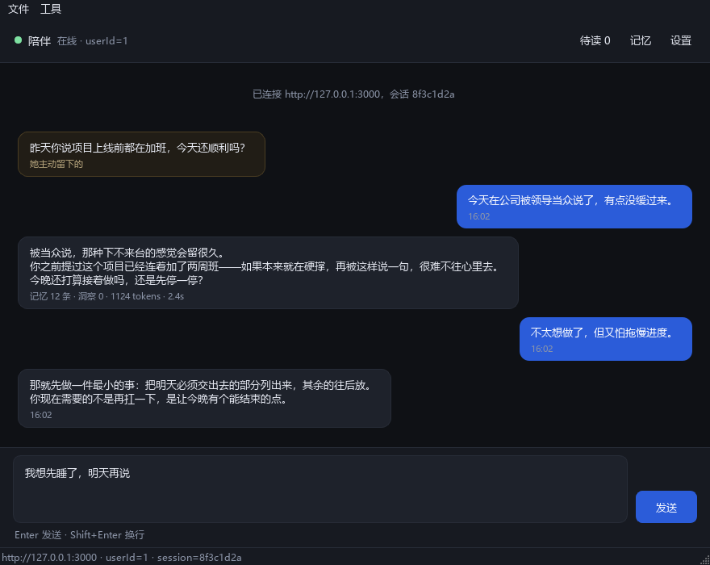
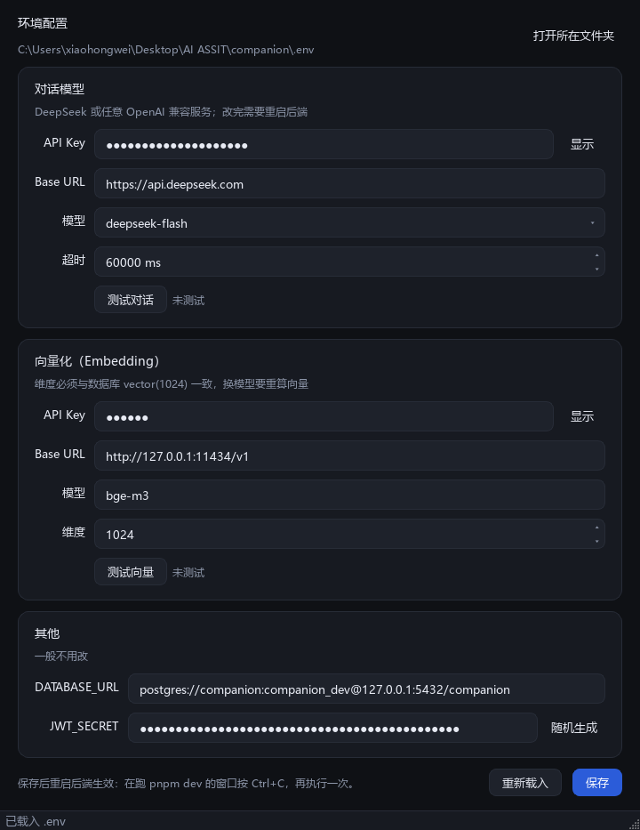

# 陪伴 · 桌面端

用**系统已有的 Python 3.12 + PySide6 6.9** 写的 Qt6 桌面客户端，不引入任何新依赖。



## 跑起来

后端要先起着（三个终端，或前两条已有就只起第三条）：

```powershell
pnpm pg:wasm      # 数据库（WASM 版，5433）
pnpm mock:llm     # LLM 替身（有 DeepSeek Key 时改成 pnpm dev）
pnpm dev:wasm     # 后端（3000）
```

然后双击 `run.bat`，或：

```powershell
cd apps\desktop
D:\Python\Python3.14\python.exe main.py
```

`run.bat` 会自己找 Python、检查 PySide6（缺了才装），出错时停住不闪退。

## 配置：可视化改 `.env`



改 API key 最常发生在**后端起不来的时候**，所以配置器不经过后端，直接读写 `companion/.env`：

```powershell
config.bat                                  # 双击，或在应用里按 Ctrl+K
D:\Python\Python3.14\python.exe configurator.py
```

- 三个区块：对话模型 / 向量化 / 其他（DATABASE_URL、JWT_SECRET）
- **先测再存**：「测试对话」发一条 `max_tokens=1` 的真实请求；「测试向量」量出实际维度并和 `EMBEDDING_DIM` 比对，不一致会当场提示（这是最难查的一类错）
- 保存时**只改值、不动注释**——`.env` 里那些"为什么这么配"的说明不会被 dotenv 的 `set_key` 洗掉
- 密钥默认打码，点「显示」才明文；JWT_SECRET 可一键随机生成

## 功能

| 功能 | 说明 |
| ---- | ---- |
| 流式对话 | `POST /chat/stream`，逐 token 渲染，可随时关窗中断（会 abort 上游） |
| 记忆召回 | 每轮 `meta` 里显示召回条数、token 预算，底部实时更新 |
| 待读主动消息 | 启动即拉 `/proactive/pending`，以琥珀色气泡呈现 |
| 历史回填 | 按会话 ID 拉 `/chat/history`，重启不丢上下文 |
| 记忆检索 | `Ctrl+F` 打开，直接调 `/memory/search`，能看到 `both / vector / keyword` 命中路径 |
| 危机标记 | 命中安全话术时，气泡上方显示「已触发安全话术」 |
| 离线引导 | 后端没起时给出可复制的启动命令，而不是只报错 |

## 快捷键

| 键 | 动作 |
| -- | ---- |
| `Enter` | 发送 |
| `Shift+Enter` | 换行 |
| `Ctrl+K` | 打开配置器（改 key / 模型） |
| `Ctrl+,` | 设置（服务地址 / openid / 会话） |
| `Ctrl+F` | 记忆检索 |
| `Ctrl+R` | 拉取待读消息 |
| `Ctrl+Q` | 退出 |

## 结构

```text
apps/desktop/
├── main.py                 入口：QApplication + 全局字体 + 样式
├── configurator.py         配置器：可视化改 .env
├── companion/
│   ├── api.py              ApiClient：登录 / SSE / 待读 / 历史 / 检索
│   ├── window.py           主窗口、设置对话框、记忆检索对话框
│   ├── widgets.py          气泡、输入框、状态点、滚动容器
│   ├── envfile.py          .env 读写（保留注释与顺序）
│   ├── probe.py            DeepSeek / embedding 连通性探测
│   ├── theme.py            深色配色、QSS、QPalette
│   └── fonts.py            中文字体解析（找不到就注册 msyh.ttc）
├── assets/                 箭头图标（QSS 接管绘制后必须自带）
├── tools/
│   ├── api_smoke.py        无界面联调：登录 + SSE + 待读，退出码可用于 CI
│   ├── config_smoke.py     .env 读写保真 + 探测 + 配置器截图
│   └── preview.py          离屏渲染对话界面预览图
├── docs/                   预览图
└── run.bat / config.bat
```

## 关键实现

**SSE 用 QNetworkAccessManager，不用线程池。**
`readyRead` 里把字节喂给增量 UTF-8 解码器（`codecs.getincrementaldecoder`），
再按 `\n\n` 切事件块。这样多字节汉字被拆在两个 TCP 包里也不会乱码——
这是自己拼 buffer 最容易踩的坑。

**气泡宽度按字宽自适应。**
`QLabel(wordWrap=True)` 的 `sizeHint` 会退化成很窄的一列，
所以 `Bubble._fit()` 用 `QFontMetrics.horizontalAdvance` 算最长一行的自然宽度，
再夹到「窗口宽度 74%」的上限内，气泡才会贴住文字而不是留一片空白。

**字体兜底。**
某些环境（沙箱、精简 Qt 部署、远程会话）里 `QFontDatabase.families()` 是空的，
中文会全变方块。`fonts.apply_app_font()` 检测到这种情况会直接
`addApplicationFont("C:\Windows\Fonts\msyh.ttc")` 兜住。

## 自测

```powershell
# 1) 语法检查
D:\Python\Python3.14\python.exe -m py_compile main.py configurator.py companion\*.py tools\*.py

# 2) 无界面联调（后端要起着），退出码 0 表示通过
D:\Python\Python3.14\python.exe tools\api_smoke.py

# 3) 配置器自检：.env 读写保真 + 对 mock 探测连通性
D:\Python\Python3.14\python.exe tools\config_smoke.py

# 4) 重新生成预览图
D:\Python\Python3.14\python.exe tools\preview.py ..\..\var
D:\Python\Python3.14\python.exe tools\config_smoke.py --shot ..\..\var\preview-config.png
```

`api_smoke.py` 覆盖：健康检查 → 登录 → 待读接口 → `meta`（含召回条数）→ 流式 token 计数 → 完成。
`config_smoke.py` 覆盖：改值生效 / 新键追加 / 注释保留 / 其他键不受影响 / 带空格值自动加引号 / 两个接口探测 + 维度比对。

## 已知限制

- 只有单一会话（会话 ID 在设置里，可重置）；后端没有「会话列表」接口，多会话要加接口
- 不做本地缓存：断网后看不到历史，重连会重新拉取
- 没有打包成 exe；需要分发时用 `pyinstaller --noconsole main.py`
- 主动消息靠后端直推（Bark / Server酱等），桌面端自身不弹系统通知
